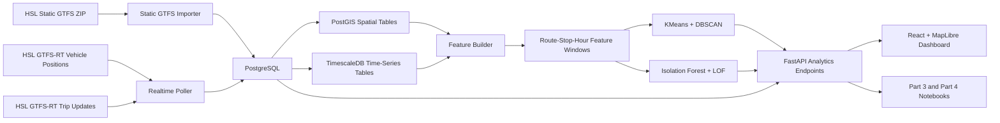
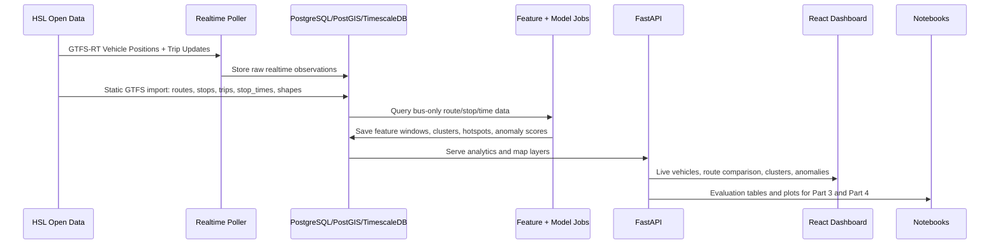

# HSL Bus Reliability Project: Presentation And Architecture Guide

This guide is for your final explanation, viva, and slide preparation. It connects Part 1, Part 2, Part 3, Part 4, and the dashboard into one clear story.

## 1. One-Sentence Project Story

This project analyzes **HSL Helsinki bus reliability** by combining planned service from **Static GTFS** with live operational evidence from **GTFS-RT**, then using clustering and anomaly detection to identify reliability patterns, hotspots, and unusual bus-operation windows.

## 2. What To Say First

Start with the problem, not the technology.

Suggested opening:

> Public transport planners need to understand not only where buses are scheduled to run, but how reliably buses are operating in practice. I used HSL Static GTFS and GTFS-RT data to build a bus-only reliability analysis system. The project converts raw schedules and realtime updates into route-stop-hour features, applies clustering and anomaly detection, evaluates the models, and visualizes the results in an interactive dashboard.

## 3. Why Bus-Only?

The raw HSL GTFS feed contains multiple transport modes. The project focuses only on bus-family route types:

| Route type | Meaning in this project |
|---:|---|
| `701` | HSL bus-family service |
| `702` | HSL bus-family service variant |
| `704` | HSL bus-family service variant |

Explain it like this:

> I narrowed the project to buses because bus reliability is strongly affected by road traffic, stop delays, and realtime prediction quality. A bus-only scope keeps the modelling consistent and avoids mixing metro, tram, rail, ferry, and bus behavior in the same model.

Important distinction:

- `route_type` means transport mode/category.
- `route_short_name` means the visible bus line, such as `52`, `510`, or `901`.
- `route_id` is the internal GTFS identifier.

## 4. End-To-End Architecture

## 5. Module Explanation

| Module | What it does | Why it matters |
|---|---|---|
| Static GTFS importer | Loads routes, stops, trips, stop times, shapes, calendars | Gives the planned transport network |
| GTFS-RT poller | Fetches live vehicle positions and trip updates repeatedly | Stores realtime bus movement and prediction evidence |
| Database | Stores relational, spatial, and time-series data | Makes route, stop, geometry, and time-window analysis possible |
| Feature builder | Aggregates raw data into route-stop-hour windows | Converts messy feeds into model-ready rows |
| Clustering jobs | Runs KMeans and DBSCAN | Finds reliability groups and hotspots |
| Anomaly jobs | Runs Isolation Forest and LOF | Finds unusual bus-operation windows |
| FastAPI backend | Serves status, route, model, cluster, anomaly, and map data | Connects notebooks/dashboard to the same source of truth |
| Dashboard | Shows live buses, route details, clusters, hotspots, and anomalies | Makes the analysis explainable visually |
| Notebooks | Document data science steps, metrics, plots, and interpretation | Main graded evidence for the exam |

## 6. Data Flow

## 7. What Each Course Part Covers

| Course part | What we did | Evidence |
|---|---|---|
| Part 1: Data Understanding | Chose HSL public transport data, described GTFS/GTFS-RT, defined bus reliability problem | Section 1 notebook, README |
| Part 2: Preprocessing | Filtered bus route types, converted timestamps, engineered delay/coverage/freshness features, aggregated route-stop-hour windows | Section 1/2 notebook, backend feature builder |
| Part 3: Data Mining | Used KMeans and DBSCAN for clustering; Isolation Forest and LOF for anomaly detection | `03_data_mining_gtfs_rt.ipynb` |
| Part 4: Evaluation | Evaluated clusters and anomalies with metrics, plots, interpretation, and limitations | `04_model_evaluation_interpretation.ipynb` |
| Presentation | Communicates the project story, dashboard, insights, and limitations | This guide and dashboard |

## 8. Part 3 Techniques To Explain

### KMeans

Purpose:

> Groups route-stop-hour windows into broad reliability profiles.

Metrics:

- Silhouette Score: higher is better.
- Davies-Bouldin Index: lower is better.
- Calinski-Harabasz Score: higher is better.

How to explain:

> KMeans helps reduce thousands of route-stop-hour windows into a small number of reliability groups. In our project, it helps separate broadly reliable behavior from watch/problematic behavior.

### DBSCAN

Purpose:

> Finds dense reliability hotspot areas and leaves weak/noisy points outside clusters.

Key parameters:

- `eps`: neighborhood distance.
- `min_samples`: minimum nearby points needed to form a dense cluster.

How to explain:

> DBSCAN is useful because bus reliability problems are often spatially concentrated around stops, corridors, or terminals. It helps identify where planners should investigate first.

### Isolation Forest

Purpose:

> Detects globally unusual bus reliability windows.

How to explain:

> Isolation Forest finds points that are easy to separate from normal data. It is useful for detecting unusual delay, coverage, or feed-freshness patterns.

### LOF

Purpose:

> Detects locally unusual windows compared with similar nearby observations.

How to explain:

> LOF is useful because what is normal on one route or time period may be unusual somewhere else. It compares each window with its local neighborhood.

## 9. Part 4 Evaluation Summary

Part 4 should be explained as:

> I evaluated clustering with internal clustering metrics because there are no true cluster labels. I evaluated anomaly detection with pseudo-labels because there are no official anomaly labels. The pseudo-labels represent operationally suspicious cases such as extreme delays, coverage dropouts, stale feeds, and late-heavy windows.

Key metric meanings:

| Metric | Used for | Meaning |
|---|---|---|
| Silhouette Score | Clustering | Higher means better separation |
| Davies-Bouldin Index | Clustering | Lower means less overlap |
| Calinski-Harabasz Score | Clustering | Higher means stronger cluster structure |
| Precision@K | Anomaly detection | How many top alerts are useful according to pseudo-labels |
| Recall | Anomaly detection | How much suspicious behavior is captured |
| F1 proxy | Anomaly detection | Balance between precision and recall |
| False-alarm share | Anomaly detection | How many alerts may be unnecessary |

## 10. Dashboard Walkthrough

Use this order when presenting the dashboard:

1. Show the live map and say it displays bus-only GTFS-RT vehicles.
2. Show the route explorer and explain that routes are filtered to bus route types `701`, `702`, and `704`.
3. Select a route and explain route-level OTP, delay, coverage, live buses, and stop status.
4. Turn on cluster layer and explain KMeans/DBSCAN reliability patterns.
5. Turn on anomaly layer and explain it as a watchlist, not confirmed disruptions.
6. Click a bus dot and explain live vehicle details, next stop, route, GTFS-RT context, and delay prediction.
7. Show statistical analytics: route health distribution, prediction coverage, route ranking, cluster profile, anomaly pressure.

## 11. Suggested 10-Minute Presentation Structure

| Time | Slide | What to say |
|---:|---|---|
| 0:00-0:45 | Title and objective | HSL bus reliability using GTFS and GTFS-RT |
| 0:45-1:45 | Dataset | Static GTFS vs GTFS-RT, why bus-only |
| 1:45-2:45 | Preprocessing | Filtering, timestamp features, route-stop-hour windows |
| 2:45-4:15 | Part 3 models | KMeans, DBSCAN, Isolation Forest, LOF |
| 4:15-5:45 | Part 4 evaluation | Metrics and why each metric is appropriate |
| 5:45-7:15 | Dashboard demo | Live map, route explorer, clusters, anomalies, vehicle popup |
| 7:15-8:30 | Insights | Hotspots, coverage, anomaly watchlist, route reliability |
| 8:30-9:30 | Limitations | Limited history, pseudo-labels, missing trip IDs, bus-only scope |
| 9:30-10:00 | Conclusion | What was achieved and future work |

## 12. Slide Checklist

Include these slides:

- Title: HSL Bus Reliability Analyzer.
- Problem statement: schedule adherence and realtime reliability.
- Dataset: Static GTFS and GTFS-RT.
- Architecture diagram.
- Preprocessing and feature engineering.
- Part 3 models.
- Part 4 evaluation metrics.
- Results and dashboard screenshots.
- Insights for urban mobility.
- Limitations and future work.

## 13. What To Keep As Proof

Keep these ready during presentation:

- `notebooks/03_data_mining_gtfs_rt.ipynb`
- `notebooks/04_model_evaluation_interpretation.ipynb`
- Dashboard: `http://localhost:5173/`
- API status: `http://localhost:8000/api/v1/models/status`
- README: project explanation and run instructions.
- This guide.

## 14. Main Challenges And How We Solved Them

| Challenge | Why difficult | Solution |
|---|---|---|
| HSL feed is multimodal | Mixing modes would confuse reliability interpretation | Bus-only route type filter |
| GTFS-RT can be messy | Realtime data may miss stable trip IDs or delay fields | Use TripUpdates, stop predictions, coverage, and freshness features |
| No official anomaly labels | Cannot evaluate anomaly detection like supervised classification | Use pseudo-labels and state limitation clearly |
| Docker not always running | GTFS-RT history only accumulates when poller is on | Store realtime rows in database and explain limitation |
| Too many dashboard overlays | Map became visually crowded | Reorganized map decks into non-overlapping rails |
| Missing values shown as `n/a` | Looked like broken UI | Replaced with meaningful labels and live OTP fallback |

## 15. Final Conclusion To Memorize

> This project successfully builds a bus-only HSL reliability analysis pipeline. Static GTFS provides the planned network, GTFS-RT provides live operational evidence, PostgreSQL/PostGIS/TimescaleDB store the data, FastAPI exposes analytics, and React/MapLibre visualizes the results. For data mining, KMeans and DBSCAN reveal reliability patterns and hotspots, while Isolation Forest and LOF detect unusual operation windows. The Part 4 evaluation uses appropriate clustering and anomaly metrics and explains the operational meaning, limitations, and future improvements.

