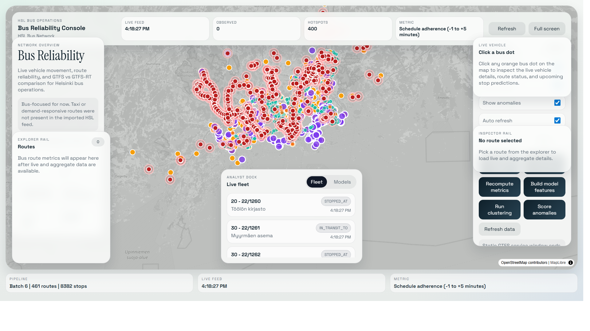

<!-- BUS_ONLY_MODEL_SNAPSHOT -->
# Saved Bus-Only Model Snapshot

Generated from the running local API on `2026-04-27T06:20:30.639Z`.

This notebook is scoped to **HSL bus reliability only** using GTFS route types `701`, `702`, and `704`. Raw GTFS/GTFS-RT ingestion remains broader for reproducibility, but modelling, interpretation, and dashboard evidence are bus-focused.

## Current API Evidence

| Evidence item | Value |
|---|---:|
| Latest vehicle-position poll | 2026-04-27T06:20:16.155275Z |
| Latest trip-update poll | 2026-04-27T06:20:16.223731Z |
| Model feature windows | 164538 |
| Latest feature bucket | 2026-04-27T06:00:00+00:00 |
| Cluster assignments | 6000 |
| DBSCAN hotspots | 416 |
| Active live anomalies | 338 |
| Average prediction coverage | 0.974 |

## Selected Models From Latest Run

| Technique | Selected parameters | Key evaluation |
|---|---|---|
| KMeans | `{"k":2,"n_init":20}` | silhouette=0.681, Davies-Bouldin=0.557, Calinski-Harabasz=9292.197 |
| DBSCAN | `{"eps":0.4,"min_samples":15}` | silhouette=0.621, noise share=0.045, clusters=4 |
| Isolation Forest | `{"max_samples":256,"n_estimators":100,"contamination":0.05}` | Precision@K=0.508, recall=0.506, false-alarm share=0.025 |
| Local Outlier Factor | `{"n_neighbors":10,"contamination":0.02}` | Precision@K=0.141, recall=0.056, false-alarm share=0.017 |

Saved machine-readable evidence:

- `../reports/snapshots/bus_model_snapshot_latest.json`
- `../reports/snapshots/bus_model_snapshot_compact.json`
- `../reports/snapshots/bus_model_snapshot_20260427T062030Z.json`
- `../reports/snapshots/bus_model_snapshot_compact_20260427T062030Z.json`
- `../reports/history_exports/` for CSV exports of recent bus GTFS-RT/model history.

Dashboard screenshot evidence:

